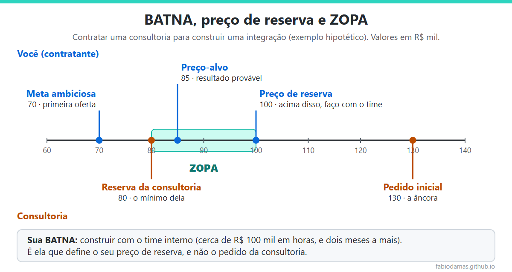

    

Comecei nesta semana a disciplina de **Negociação e Administração de Conflitos**, no MBA da [@FGV](https://www.linkedin.com/school/fgv/). Ainda estou no começo, mas um conceito já mudou o jeito como eu enxergo qualquer negociação: a **BATNA**.

Quem trabalha com tecnologia negocia o tempo todo, mesmo sem chamar assim. Negociamos prazo com produto, escopo com a área de negócio, prioridade com outros times e preço com fornecedores. Neste artigo, registro o que estou aprendendo, com exemplos do meu dia a dia de engenharia.

## Contexto: conflito não é o problema

A primeira ideia da disciplina foi desconfortável: conflito não é algo a eliminar. É a condição que antecede e motiva a negociação. A pensadora da administração Mary Parker Follett já defendia, no início do século passado, que o conflito não deve ser condenado nem enaltecido, e sim usado.

Em tecnologia, isso faz sentido. A tensão entre "entregar rápido" e "entregar com qualidade" não desaparece. Quando ela é ignorada, vira retrabalho, atrito entre times e decisões tomadas por cansaço. Quando é tratada como negociação, vira escolha consciente.

## O que é BATNA

**BATNA** é a sigla de *Best Alternative to a Negotiated Agreement*, termo criado por Roger Fisher e William Ury no livro *Getting to Yes* (1981), publicado no Brasil como *Como Chegar ao Sim*. Em português, também aparece como **MAAN**: a melhor alternativa à negociação de um acordo.

É simples: é o que você vai fazer se não houver acordo. E é por isso que ela importa tanto. A BATNA funciona como uma régua para avaliar cada proposta: se a proposta é pior do que a sua alternativa, você não deveria aceitar.

Junto com ela, a aula trouxe três conceitos que se completam:

- **Preço de reserva:** o ponto-limite em que você ainda aceita um acordo. É ele que você nunca revela.
- **Meta ambiciosa:** o melhor resultado que você pode defender com argumentos. É o ponto de partida, não de chegada.
- **ZOPA** (*Zone of Possible Agreement*): o intervalo entre o preço de reserva de um lado e o do outro. Se não existe ZOPA, não existe acordo possível.

Uma forma de resumir: a BATNA define se vale a pena entrar na negociação; o preço de reserva define onde você sai; e a ZOPA mostra se há espaço para um acordo.

## Um exemplo de tecnologia

Imagine que um time precisa de uma integração nova e recebe a proposta de uma consultoria. O exemplo é hipotético:

    

A consultoria pede R$ 130 mil. Sem pensar na BATNA, a tendência é negociar a partir desse número e comemorar se ele cair para R$ 115 mil. Com a BATNA, a pergunta muda: o que eu faço se não fechar? Neste caso, construir com o time interno, por cerca de R$ 100 mil em horas e com dois meses a mais de prazo.

Essa alternativa define o preço de reserva. Acima de R$ 100 mil, é melhor fazer em casa. Como a consultoria aceitaria a partir de R$ 80 mil, a ZOPA vai de R$ 80 mil a R$ 100 mil. Os R$ 115 mil que pareciam uma vitória estariam, na verdade, fora da zona de acordo.

Dois detalhes que aprendi nesse tipo de conta:

- **A BATNA não é só dinheiro.** Os dois meses a mais de prazo também pesam. Se o prazo for crítico, a alternativa fica mais fraca, e o preço de reserva sobe.
- **A âncora engana.** O primeiro número apresentado vira referência para a conversa inteira. Quem conhece a própria BATNA resiste melhor a ela.

## Posições bloqueiam, interesses abrem

Outra ideia clássica de Fisher e Ury: as pessoas negociam **posições** ("quero X"), mas o acordo aparece quando se descobrem os **interesses** ("para que você quer X?").

Um exemplo do dia a dia:

| | Produto | Engenharia |
|---|---|---|
| **Posição** | "Tudo pronto até o dia 30." | "Não dá. São seis semanas de trabalho." |
| **Interesse** | Mostrar o fluxo principal ao cliente na reunião do dia 30. | Não colocar em produção algo sem testes e sem monitoramento. |
| **Opção que atende os dois** | Entregar o fluxo principal até o dia 30, atrás de uma feature flag, com testes e alertas. O restante vem nas semanas seguintes. | |

Discutindo posições, um dos lados perde. Investigando interesses, a negociação deixa de ser só dividir algo fixo e passa a criar valor antes de dividir, a diferença entre negociação distributiva e integrativa que David Lax e James Sebenius descreveram em *The Manager as Negotiator* (1986).

## Em tecnologia, a BATNA se constrói com arquitetura

Esta parte é a minha leitura, e foi a que mais me animou. Numa negociação com fornecedor, a força de uma empresa depende da qualidade da sua alternativa. E, em tecnologia, a qualidade da alternativa muitas vezes é decidida muito antes da negociação, no desenho do sistema.

Se um sistema está acoplado a um fornecedor de nuvem, de banco de dados ou de IA, sair dele custa caro, e a BATNA fica fraca. Se o sistema foi desenhado com portas e adaptadores, contratos claros e dados exportáveis, trocar de fornecedor é viável, e a BATNA fica forte. No [artigo sobre Spring AI](https://fabiodamas.github.io/2026/10/22/spring-ai-llm-local-sem-custo-por-chamada/), mostrei que dá para trocar o provedor de um LLM mudando uma propriedade. Na época, pensei nisso como boa engenharia. Hoje, vejo também como poder de negociação.

O mesmo raciocínio vale para quem negocia a própria carreira: a melhor forma de negociar bem é ter alternativas reais, e não apenas argumentos.

## Armadilhas que já reconheci em mim

A disciplina também trouxe vieses que atrapalham qualquer negociação. Três deles aparecem muito em tecnologia:

- **Mito da torta fixa:** achar que o ganho de um é necessariamente a perda do outro. O termo é do pesquisador Max Bazerman. Faz cada time defender o seu lado em vez de procurar a solução que atende os dois.
- **Escalonamento:** continuar investindo numa solução só porque já se investiu muito nela. É o projeto que ninguém tem coragem de parar.
- **Enquadramento:** a mesma escolha parece diferente quando é apresentada como ganho ou como perda, efeito estudado por Daniel Kahneman e Amos Tversky. "Reduz o risco de incidente pela metade" convence mais do que "ainda deixa metade do risco".

## Boas práticas

- **Antes de qualquer negociação, escreva a sua BATNA.** Se você não sabe o que faria sem acordo, não sabe o quanto pode ceder.
- **Fortaleça a alternativa antes de sentar à mesa.** Uma segunda proposta, um plano de fazer em casa, um sistema menos acoplado.
- **Defina o preço de reserva e não o revele.**
- **Pergunte "para quê?"** sempre que ouvir uma posição.
- **Use critérios objetivos**, como dados, benchmarks e regras, para justificar a sua proposta sem parecer arbitrário.
- **Nenhuma concessão sem pedir algo em troca.**

## Erros comuns

- **Negociar sem alternativa** e aceitar qualquer coisa melhor do que "nada".
- **Ancorar no número do outro lado** em vez de no seu próprio preço de reserva.
- **Confundir posição com interesse** e transformar a conversa em braço de ferro.
- **Esquecer quem não está na sala**, como o time que vai operar o sistema ou a área que vai pagar a conta.
- **Ver o conflito como ameaça**, e não como matéria-prima da negociação.

## O que estou aprendendo

A primeira lição é que **o poder numa negociação está fora da mesa**: na alternativa que você construiu antes de sentar.

A segunda é que **negociar bem é preparar bem**. A conversa em si é a parte menor; o trabalho está em conhecer a sua BATNA, os seus limites e os interesses do outro lado.

A terceira é que **engenharia e negociação andam juntas**. Decisões de arquitetura definem quantas alternativas uma empresa terá quando precisar negociar.

Ainda tenho mais aulas pela frente, e devo voltar a esse tema.

## Conclusão

BATNA é um conceito simples, com um efeito grande: troca a pergunta "quanto consigo arrancar do outro lado?" por "o que eu faço se não houver acordo?". Quem responde bem a essa pergunta negocia com mais calma, cede menos e reconhece um bom acordo quando ele aparece.

E você: na sua última negociação, sabia qual era a sua BATNA? Me conte pelo LinkedIn.

## Referências

- Disciplina Negociação e Administração de Conflitos, MBA FGV.
- Fisher, R.; Ury, W. *Getting to Yes* (1981). Edição brasileira: *Como Chegar ao Sim*.
- Lax, D.; Sebenius, J. *The Manager as Negotiator* (1986).
- Bazerman, M.; Neale, M. *Negociando Racionalmente*.
- Kahneman, D.; Tversky, A. Prospect Theory: An Analysis of Decision under Risk. *Econometrica*, 1979.
- Follett, M. P. *Constructive Conflict* (1925).
